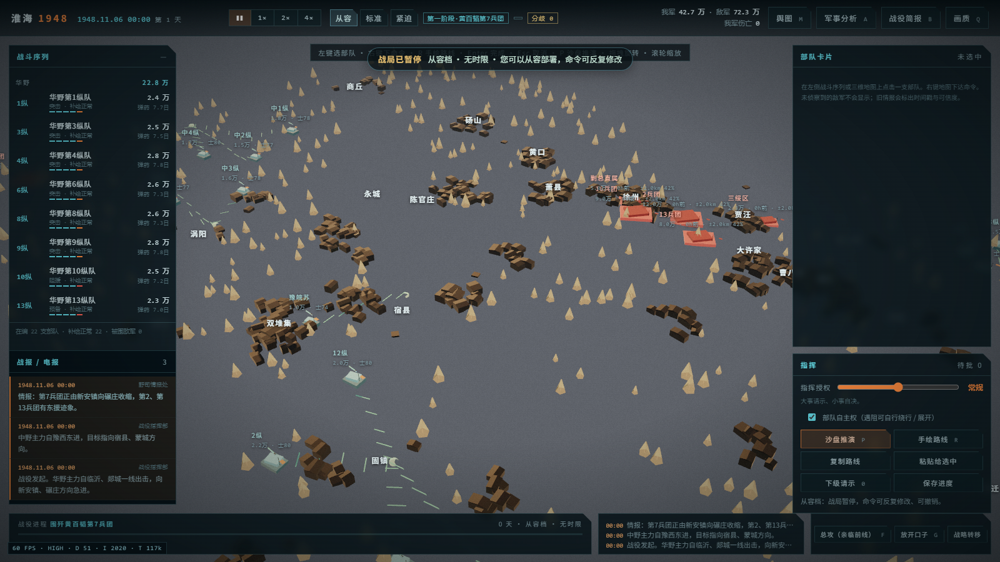
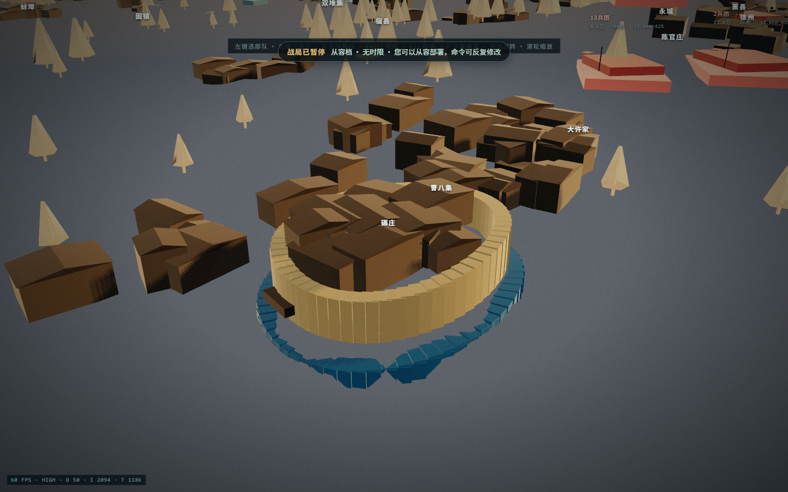
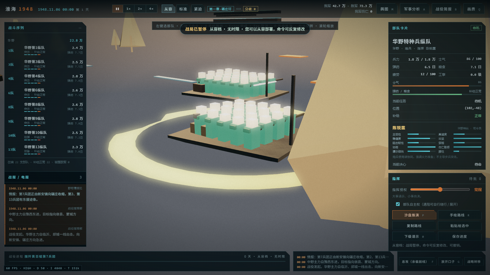
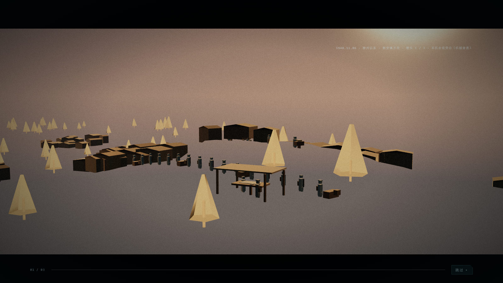

# 淮海 1948 · 粟裕视角

一个单人 3D 战争策略游戏：**战役指挥沙盘 + 可下到前线的第一人称交火 + 引擎内过场短片**。
玩家扮演粟裕，在约 320 × 380 km 的淮海战区沙盘上调动纵队、压缩包围圈，在关键战斗时亲临前线，
战后复盘可以看到自己的决策与史实走向的分歧点。

> 历史题材同人作品，不是战史研究。兵力、时间、指挥关系与地理均标注「史实 / 估算 / 游戏化演绎」。
> 项目内没有原片画面、第三方音频或任何受版权保护的素材，所有模型、贴图、音效与语音都是程序生成或本机合成的。



## 截图

| 三维舆图 | 碾庄环壕近景 |
|---|---|
|  |  |

| 逐兵 LOD（近景可辨兵种） | 引擎内过场 |
|---|---|
|  |  |

> 原始截图（149 张回归证据图）保留在本地 `shots/`，未入库以控制仓库体积。

## 玩法

- **三章战役**，按史实节点推进：
  1. 碾庄 — 围歼黄百韬第 7 兵团（约 10 万人）；
  2. 双堆集 — 围歼黄维第 12 兵团（约 12 万人）；
  3. 陈官庄 — 围歼杜聿明集团（约 30 万人）。
- **指挥层**：选中纵队 → 右键下达行军 / 包围 / 阻援 / 进攻；可手绘多段路线；
  每支部队有指挥员卡（指挥倾向、当前决心、最近一次请示）。
- **指挥链**：三档授权（严控 / 常规 / 放权）只决定下属是否需要请示，不能绕过玩家意图；
  下属只在「受阻 / 被切断 / 情报过期」这类硬条件下申请改航，改航会在 UI 上播报「谁改的、为什么、改到哪」。
- **时间**：1 个模拟 tick = 1 小时；三档节奏（从容 / 标准 / 紧迫）。
- **前线**：满足条件后可以把视角切到第一人称，在战壕与掩体间推进、射击、呼叫压制。
- **复盘**：战役结束后给出结局类型、歼敌与伤亡、关键分歧（D1–D7）与史实对照。

## 技术栈

| 层 | 技术 |
|---|---|
| 渲染 | 原生 JavaScript + 自研 WebGL2 渲染器（零第三方依赖，低多边形 / 强轮廓光 / 泛光 / 软阴影 / 程序化天空） |
| 仿真 | 确定性战役推演：固定种子、定步长、无 `Math.random`，可脚本复现 |
| UI | 原生 DOM + Canvas2D 舆图 + CSS |
| 音频 | WebAudio 程序化音效；语音由本机 Windows SAPI 预生成 WAV |
| 后端 | Spring Boot 3.2.5 / Java 17 / Maven / `JdbcTemplate` / MySQL 8 |
| 桌面 | Electron 33（便携版打包） |
| 测试 | Playwright + Edge 无头，脚本化回归与帧率测量 |

## 目录结构

```
src/                    前端源码（按加载顺序内联进 HTML 模板）
  engine.js             自研 WebGL2 渲染器：矩阵/相机、实例化批次、后处理、纹理
  data.js               史实数据：据点、河流、铁路、部队编成、阶段与结局文本
  world.js              战区地形、壕沟/掩体、据点与障碍
  sim.js                确定性战役仿真：行军、寻路、接敌、伤亡、包围、补给、事件层 fx
  fps.js                第一人称交火层
  cine.js               引擎内过场系统
  ui.js                 指挥层 HUD、部队卡、简报、舆图
  api.js                存档 REST 客户端
  game.js               场景装配、输入、LOD、逐兵与特效绘制
  styles.css            全局样式
build.js                构建：把 src 内联进模板，输出 index.html / cinematics.html
index.html              构建产物（可直接双击运行）
cinematics.html         过场单独播放页
refs/                   地理与史实参考（geo.json 等）
assets/voice/           预生成语音 WAV（约 5.5 MB / 25 条）
server/                 Spring Boot 存档服务（pom.xml、src、sql、.env.example）
desktop/                Electron 壳（main.js、pack.js、package.json）
tools/                  回归与取证脚本（Playwright / Node）
docs/screenshots/       少量关键截图
PROGRESS.md             逐轮改动记录与实测数据
```

## 本地运行

环境要求：Node.js 18+、Chrome / Edge（需 WebGL2）。后端另需 JDK 17、Maven、MySQL 8。

### 方式一：纯前端（最快，无需后端）

```bash
node build.js
# 然后双击 index.html，或
python -m http.server 8000
# 打开 http://127.0.0.1:8000/index.html
```

不需要后端时，存档写浏览器 `localStorage`。需要静音（录制 / 自动化）时打开 `index.html?mute=1`。

### 方式二：后端 + MySQL（存档落库）

```powershell
# 1) 建库（只需一次）
Get-Content server\sql\00_create_database.sql -Raw -Encoding UTF8 |
  mysql -u root -h 127.0.0.1 -P 3306 --default-character-set=utf8mb4

# 2) 只通过环境变量提供凭证（仓库内没有任何默认密码）
cd server
$env:DB_URL        = "jdbc:mysql://127.0.0.1:3306/hx1948?useUnicode=true&characterEncoding=utf8&serverTimezone=Asia/Shanghai&useSSL=false&allowPublicKeyRetrieval=true"
$env:DB_USERNAME   = "hx_app"
$env:DB_PASSWORD   = "<你的密码>"
$env:SERVER_PORT   = "8080"
mvn spring-boot:run

# 3) 打开 http://127.0.0.1:8080/index.html
#    手机在同一 Wi-Fi 下打开 http://<本机局域网IP>:8080/index.html
```

启动后建表由 `schema.sql` 自动执行，两张表：`save_slot`（存档槽）与 `after_action`（结局记录）。
接口：`GET /api/saves`、`GET|PUT /api/saves/{slot}`、`POST /api/saves/auto`、`GET|POST /api/after-action`。
没有 MySQL 时可用 `-P dev-h2` + `DB_DRIVER=org.h2.Driver` 跑开发库，仅作回退。

### 方式三：Electron 桌面端

```bash
cd desktop
npm install
npm start          # 开发态运行
npm run dist       # 打包便携版，产物在 desktop/release/（约 188 MB，不入库）
```

仓库**不包含** `desktop/release/` 下的安装包，需要本地执行 `npm run dist` 生成。

## 已实现

- 确定性战役仿真：行军 / 寻路 / 接敌 / 伤亡 / 弹药 / 包围扇区 / 补给 / 情报时效，固定种子可复现。
- 事件驱动的战斗表现：`sim.fx` 由真实结算产生，渲染层只读；包含曳光线、命中十字、炮火落点与烟尘、包围圈合拢、伤亡反馈。
- 逐兵 LOD：远景为队列色块与队标，中景为小人，近景可辨步兵 / 机枪 / 炮兵 / 担架；使用 `InstancedMesh` 批量绘制。
- 指挥链与授权档：改航必须申请并显式播报，不存在静默改航。
- 第一人称交火：指针锁定、后坐与扩散、掩体推进的敌 AI、三种战术指令。
- 引擎内过场：8 段短片，含语音与字幕，可跳过。
- 存档：本机兜底 + REST + MySQL（版本号防覆盖、`state_hash` 幂等、结局记录去重）。
- 回归脚本：三章流程、寻路、炮火、LOD 与帧率、存档往返，均有可重跑的 Node/Playwright 脚本。

## 已知限制

1. **语音是机械音**：由本机 Windows SAPI 合成，听感明显偏机械；重建脚本 `tools/gen_voice.ps1`，需要本机装有中文语音包。
2. **远景档没有逐兵**：相机距离 > 132 时只画队列色块与队标（`soldierLod` 三档：far / mid / near）。近景逐兵有上限：mid 约 800 兵/帧、near 约 960 兵/帧，超出部分不绘制。
3. **寻路是网格 A***：只做静态地形代价（河流 / 铁路 / 壕沟 / 据点），没有真正的队形避让与通行宽度建模；大规模部队会出现贴边与拥堵。
4. **竞技场是单一场地复用**：三章共用一块地形，通过不同据点、障碍与任务参数区分阶段，不是三张独立地图。
5. **后端没有鉴权与 HTTPS**：接口无登录、无 token，CORS 仅放本机端口，只适合本机或同一局域网；跨公网必须先加鉴权和反向代理。
6. **手机端只做了浏览器仿真**：竖 / 横屏截图来自 Playwright 移动端仿真，没有真机验证（地址栏、软键盘、刘海安全区差异未覆盖）。
7. **美术与音效全部程序化**：低多边形风格是主动取舍，不追求写实建模。
8. **没有多用户 / 云同步**：存档按槽位单份保存，无账号体系。

## 文档

- `PROGRESS.md`：逐轮改动记录、参数位置与实测数值（帧率、实例数、落库字节数等）。
- `refs/geo.md`、`refs/timeline.md`、`refs/sources.md`：地理、时间线与史料出处。

## 说明

本项目为个人作品集项目。史实部分参考公开战史资料，游戏内数值经过简化与平衡，不作为历史研究依据。
